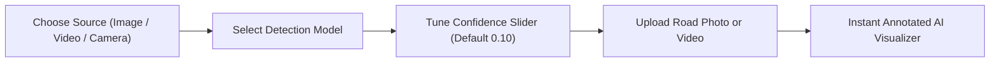
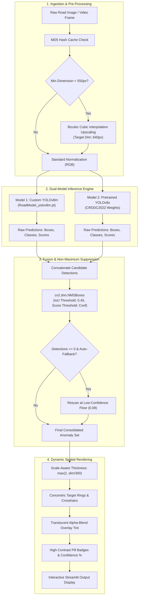
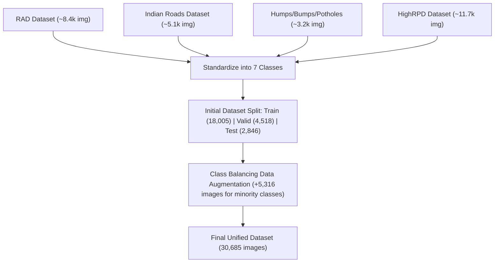

# 🛣️ AI-Powered Road Anomaly & Defect Detection System

[](https://www.python.org/)
[](https://github.com/ultralytics/ultralytics)
[](https://streamlit.io/)
[](LICENSE)

An end-to-end, real-time Computer Vision system engineered to autonomously detect, localize, and classify road surface hazards—including **potholes, longitudinal/transverse cracks, severe structural fractures, and speed bumps**—alongside contextual traffic entities (**light vehicles, heavy vehicles, and pedestrians**). 

The system leverages state-of-the-art **YOLOv8 deep neural architectures**, a **Dual-Model Ensemble engine with Non-Maximum Suppression (NMS)**, **bicubic adaptive resolution scaling**, and an interactive **Streamlit dashboard** supporting image uploads, recorded dashcam video feeds, and real-time webcam streams.

---

## 📑 Table of Contents
1. [What You Need To Do (Quick Start Guide)](#-what-you-need-to-do-quick-start-guide)
2. [System Architecture & Workflow](#-system-architecture--workflow)
3. [Deep-Dive AI & Machine Learning Concepts](#-deep-dive-ai--machine-learning-concepts)
   - [Object Detection vs. Classification vs. Segmentation](#1-object-detection-vs-classification-vs-segmentation)
   - [YOLOv8 Deep Neural Architecture](#2-yolov8-deep-neural-architecture)
   - [Loss Functions & Mathematical Formulation](#3-loss-functions--mathematical-formulation)
   - [Evaluation Metrics & Performance Mathematics](#4-evaluation-metrics--performance-mathematics)
   - [Dual-Model Ensembling & Non-Maximum Suppression (NMS)](#5-dual-model-ensembling--non-maximum-suppression-nms)
   - [Adaptive Pre-Scaling & Auto-Sensitivity Fallback](#6-adaptive-pre-scaling--auto-sensitivity-fallback)
4. [Dataset Engineering & Pipeline](#-dataset-engineering--pipeline)
5. [Trained Models & Performance Benchmarks](#-trained-models--performance-benchmarks)
6. [Training & Fine-Tuning Guide (Cloud GPU vs Local)](#-training--fine-tuning-guide-cloud-gpu-vs-local)
7. [Project Directory Layout](#-project-directory-layout)
8. [Troubleshooting & Common Questions](#-troubleshooting--common-questions)

---

## 🚀 What You Need To Do (Quick Start Guide)

If you are opening this project for the first time, follow these exact steps to run and use the application.

### Step 1: Install Dependencies
Open your PowerShell or Command Prompt in the project folder and install the required Python packages:

```powershell
pip install -r requirements.txt
```

> [!NOTE]
> Make sure `ultralytics`, `streamlit`, `opencv-python-headless`, and `supervision` are installed. If any package is missing, run `pip install ultralytics streamlit opencv-python supervision`.

### Step 2: Run the Web Dashboard
Execute the following command in your terminal:

```powershell
streamlit run main.py
```

The system will start a local web server and output:
```text
  Local URL: http://localhost:8501
  Network URL: http://192.168.x.x:8501
```
Open **[http://localhost:8501](http://localhost:8501)** in your web browser (Google Chrome, Microsoft Edge, or Mozilla Firefox).

### Step 3: Using the Application Interface



1. **Select Input Mode in the Sidebar**:
   - **Image**: Upload any `.jpg`, `.jpeg`, or `.png` photo of a road.
   - **Video**: Upload an `.mp4`, `.avi`, or `.mov` dashcam video recording.
   - **Live Camera**: Connect your webcam or dashcam for real-time analysis.
2. **Configure AI Settings**:
   - **Detection Model**:
     - `Ensemble (Model 1 + Model 2)` *(Recommended)*: Combines both models to detect both road defects and surrounding traffic.
     - `Model 1 Only`: Focuses on 7 unified classes (Potholes, Cracks, Severe Cracks, Speed Bumps, Vehicles, Pedestrians).
     - `Model 2 Only`: Highly sensitive specifically to asphalt cracks (longitudinal, transverse, alligator) and potholes.
   - **Confidence Threshold**: Set between `0.05` and `0.90` (default is **0.10** for capturing faint or shadowed defects).
   - **Mark Style**:
     - `Target Circle & Box`: Displays concentric tactical targeting rings over defects with bounding boxes.
     - `Circle Only`: Minimalist circular target reticles.
     - `Box Only`: Classic computer vision bounding boxes with confidence tags.
   - **Auto-Sensitivity Fallback**: Keep this checked. If an uploaded image contains a faint defect below your slider threshold, the engine automatically performs a secondary scan down to `0.08` confidence so subtle potholes are not missed.

---

## 🏛️ System Architecture & Workflow

The following diagram illustrates how raw image or video data flows through the AI processing engine in [main.py](file:///c:/Users/HP/OneDrive/Desktop/road-anomaly-detection-main/main.py):



---

## 🧠 Deep-Dive AI & Machine Learning Concepts

### 1. Object Detection vs. Classification vs. Segmentation

| Task | What the Model Predicts | Output Format | Computational Cost |
| :--- | :--- | :--- | :--- |
| **Image Classification** | What is in the overall image? (e.g., "Pothole road") | Single label + probability | Very Low |
| **Object Detection (Our Approach)** | *What* anomalies exist and *where* are they located? | Bounding boxes $(x, y, w, h)$, class labels, confidence scores | **Low / Real-Time (12ms)** |
| **Instance Segmentation** | Pixel-by-pixel exact boundary mask of each anomaly | Polygon contour / binary mask per object | High |

**Why Single-Stage Object Detection (YOLOv8) was chosen**:
Autonomous vehicles and municipal inspection vehicles operate at highway speeds (60–100 km/h). At 100 km/h, a vehicle travels ~27.7 meters per second. Traditional two-stage detectors (like Faster R-CNN) require 80–150 ms per frame, causing unacceptable detection lag. YOLOv8 processes each frame in **~12 ms**, enabling instantaneous real-time hazard avoidance.

---

### 2. YOLOv8 Deep Neural Architecture

YOLOv8 (*You Only Look Once*, Version 8) developed by Ultralytics is an **anchor-free, single-stage convolutional neural network**. It consists of three primary components:

```
[Input: 640x640x3]
         │
    ▼ Backbone (Modified CSPDarknet53 + C2f + SPPF)
         │
    ▼ Neck (Path Aggregation Network - PANet / FPN)
         │
    ▼ Head (Decoupled Anchor-Free Regression & Classification)
         │
[Output: Bounding Boxes + Class Probabilities]
```

#### A. Backbone (Feature Extraction)
The backbone extracts hierarchical feature representations across multiple spatial scales:
- **C2f Modules (Cross-Stage Partial with 2 Convolutions)**: Combines high-level semantic abstractions with low-level gradient paths. Inspired by ELAN (Efficient Layer Aggregation Networks), C2f splits feature channels into two branches, processes one through multiple bottleneck residual blocks, and concatenates them back. This maintains rich gradient flow without ballooning parameter count.
- **SPPF (Spatial Pyramid Pooling - Fast)**: Pools features at kernel sizes $5 \times 5$, $9 \times 9$, and $13 \times 13$ sequentially rather than in parallel. This exponentially increases the receptive field, allowing the network to detect large road features (like speed bumps across the whole lane) as well as tiny hairline asphalt cracks without losing spatial context.

#### B. Neck (Multi-Scale Feature Fusion)
Road defects vary drastically in physical scale: a small gravel pothole may occupy $30 \times 30$ pixels, whereas an elongated road crack can stretch across $500$ pixels. YOLOv8 uses a **PANet (Path Aggregation Network)** structure:
- **Feature Pyramid Network (FPN)**: Passes semantic context from deep, low-resolution layers down to shallow, high-resolution layers.
- **Path Aggregation Path**: Passes precise spatial localization features back up from shallow layers to deep layers.
- Predictions are generated across three distinct scale feature maps:
  - **$P_3$ ($80 \times 80$)**: Detects small defects (hairline cracks, early-stage potholes).
  - **$P_4$ ($40 \times 40$)**: Detects medium hazards (large potholes, debris, pedestrians).
  - **$P_5$ ($20 \times 20$)**: Detects large entities (speed bumps, heavy vehicles, trucks).

#### C. Decoupled Anchor-Free Detection Head
Traditional object detectors (YOLOv3–v5) used predefined "anchor boxes" with fixed aspect ratios. YOLOv8 uses an **anchor-free decoupled head**:
- **Decoupled Design**: Separates the classification task (object identity) from the regression task (bounding box coordinates) into two independent sub-networks. This resolves task conflicts because classification requires spatial invariance, whereas localization demands spatial precision.
- **Anchor-Free Mechanism**: Directly predicts the distance from the cell center to the 4 bounding box edges $(t, b, l, r)$ rather than estimating offsets from rigid anchors. This drastically reduces hyperparameter tuning and enhances detection recall on irregularly shaped road cracks.

---

### 3. Loss Functions & Mathematical Formulation

YOLOv8 optimizes a composite multi-task loss function during training:

$$\mathcal{L}_{\text{total}} = \lambda_{\text{box}} \mathcal{L}_{\text{CIoU}} + \lambda_{\text{dfl}} \mathcal{L}_{\text{DFL}} + \lambda_{\text{cls}} \mathcal{L}_{\text{BCE}}$$

Where:
- $\lambda_{\text{box}} = 7.5$, $\lambda_{\text{dfl}} = 1.5$, $\lambda_{\text{cls}} = 0.5$ (scaling weights).

#### 1. Complete Intersection over Union (CIoU) Loss ($\mathcal{L}_{\text{CIoU}}$)
Standard IoU only measures overlap. If two boxes do not overlap, standard IoU is zero and provides zero gradient. CIoU accounts for overlap area, centroid distance, and aspect ratio:

$$\mathcal{L}_{\text{CIoU}} = 1 - \text{IoU} + \frac{\rho^2(b, b^{gt})}{c^2} + \alpha v$$

Where:
- $\text{IoU} = \frac{|B \cap B^{gt}|}{|B \cup B^{gt}|}$
- $\rho(b, b^{gt})$ is the Euclidean distance between the central points of predicted box $b$ and ground truth box $b^{gt}$.
- $c$ is the diagonal length of the smallest enclosing box covering both regions.
- $v$ measures the consistency of aspect ratios:
  $$v = \frac{4}{\pi^2} \left( \arctan\frac{w^{gt}}{h^{gt}} - \arctan\frac{w}{h} \right)^2$$
- $\alpha$ is a weighting parameter: $\alpha = \frac{v}{(1 - \text{IoU}) + v}$.

#### 2. Distribution Focal Loss ($\mathcal{L}_{\text{DFL}}$)
Road cracks and potholes often have indistinct, blurred, or irregular edges. Instead of treating coordinate regression as a single deterministic Dirac delta scalar, DFL models the bounding box boundaries as a continuous probability distribution $\mathbf{P}(x)$:

$$\mathcal{L}_{\text{DFL}}(S_i, S_{i+1}) = - \left( (y_{i+1} - y) \log(S_i) + (y - y_i) \log(S_{i+1}) \right)$$

This forces the network to concentrate probability density around the true defect boundary, providing robust localization even in poor lighting or wet asphalt conditions.

#### 3. Binary Cross-Entropy Loss ($\mathcal{L}_{\text{BCE}}$)
Used for multi-class classification across all anchor-free points:

$$\mathcal{L}_{\text{BCE}} = - \sum_{i=1}^C \left[ y_i \log(\hat{y}_i) + (1 - y_i) \log(1 - \hat{y}_i) \right]$$

---

### 4. Evaluation Metrics & Performance Mathematics

```
                Actual Positive      Actual Negative
Predicted Pos:   True Pos (TP)        False Pos (FP)  --> Precision = TP / (TP + FP)
Predicted Neg:   False Neg (FN)       True Neg (TN)   --> Recall    = TP / (TP + FN)
```

- **Intersection over Union (IoU)**: Ratio of overlap between prediction and ground-truth annotation. A detection is counted as a True Positive (TP) only if $\text{IoU} \ge 0.50$.
- **Precision ($P$)**: Out of all defects the AI flagged, what fraction were real defects?
  $$P = \frac{\text{TP}}{\text{TP} + \text{FP}}$$
- **Recall ($R$)**: Out of all defects actually on the road, what fraction did the AI find?
  $$R = \frac{\text{TP}}{\text{TP} + \text{FN}}$$
- **F1-Score**: Harmonic mean balancing Precision and Recall:
  $$F_1 = 2 \cdot \frac{P \cdot R}{P + R}$$
- **Average Precision (AP) & mAP**: The area under the Precision-Recall curve:
  $$\text{AP} = \int_{0}^1 P(R) \, dR$$
  $$\text{mAP} = \frac{1}{N} \sum_{k=1}^N \text{AP}_k$$
  - **mAP@0.5**: Average precision calculated when threshold is fixed at $\text{IoU} = 0.50$.
  - **mAP@0.5:0.95**: Comprehensive COCO evaluation metric averaged over 10 distinct IoU thresholds ($0.50, 0.55, \dots, 0.95$).

---

### 5. Dual-Model Ensembling & Non-Maximum Suppression (NMS)

Real-world roads present diverse anomalies. Model 1 was trained on our 30,000+ multi-source dataset (excelling at large potholes, speed bumps, and vehicle/pedestrian context). Model 2 was trained on CRDDC2022 (excelling at structural pavement micro-fissures).

[main.py](file:///c:/Users/HP/OneDrive/Desktop/road-anomaly-detection-main/main.py) implements an **Ensemble Pipeline**:
1. Both models run independent forward passes on the input tensor.
2. Candidate bounding boxes $\mathcal{B} = \{b_1, b_2, \dots, b_n\}$ and scores $\mathcal{S} = \{s_1, s_2, \dots, s_n\}$ are merged into a unified candidate pool.
3. **Non-Maximum Suppression (NMS)** eliminates redundant, overlapping bounding boxes:
   - Boxes are sorted descending by confidence score.
   - The top candidate $b_{\text{best}}$ is selected.
   - Any remaining candidate $b_j$ with $\text{IoU}(b_{\text{best}}, b_j) > 0.45$ is suppressed.
   - The process repeats until only distinct, mutually exclusive defect locations remain.

$$\text{IoU}(A, B) = \frac{\text{Area}(A \cap B)}{\text{Area}(A \cup B)}$$

---

### 6. Adaptive Pre-Scaling & Auto-Sensitivity Fallback

Many road photos downloaded from web sources or dashcam thumbnails have low spatial resolutions ($200 \times 289$ px). Convolutional feature maps at stage $P_5$ downsample inputs by a factor of 32 ($200 / 32 \approx 6$ pixels), causing faint potholes to completely disappear from feature representations.

To resolve this, [main.py](file:///c:/Users/HP/OneDrive/Desktop/road-anomaly-detection-main/main.py) incorporates two adaptive vision techniques:
1. **Bicubic Cubic Pre-Scaling**:
   - If $\min(\text{height}, \text{width}) < 550\text{ px}$, the image is dynamically upscaled using high-order bicubic interpolation ($f(x, y) = \sum \sum a_{ij} x^i y^j$) up to a minimum dimension of $640\text{ px}$. This expands sub-pixel gradient features, allowing shallow convolutional filters to lock onto defect boundaries.
2. **Auto-Sensitivity Fallback**:
   - Circular potholes in shaded asphalt often exhibit lower raw confidence (~$0.12 - 0.20$). If zero defects are detected at the user's selected slider threshold, the engine automatically re-evaluates down to a safety floor of $0.08$. If candidates are found, they are surfaced with an informational notice so the user is never left wondering why a visible defect was ignored.

---

## 📊 Dataset Engineering & Pipeline

Our primary model was trained on a standardized, aggregated dataset of **30,685 road images**:



### The 7 Unified Target Classes
1. `Heavy-Vehicle`: Buses, trucks, multi-axle commercial transport.
2. `Light-Vehicle`: Cars, SUVs, auto-rickshaws, motorcycles.
3. `Pedestrian`: Humans on sidewalks or road surfaces.
4. `Crack`: Longitudinal and transverse surface fissures.
5. `Crack-Severe`: Deep structural pavement disintegration.
6. `Pothole`: Cavities and asphalt depressions.
7. `Speed-Bump`: Asphalt mounds and speed-calming humps.

---

## 📈 Trained Models & Performance Benchmarks

### Model 1: Custom YOLOv8m (`best.pt`)
- **Weights File:** `RoadDetectionModel/RoadModel_yolov8m.pt_rounds120_b9/weights/best.pt`
- **Architecture:** YOLOv8 Medium (25.8 Million Parameters, 79.1 GFLOPs)
- **Training Epochs:** 120 epochs on NVIDIA RTX 3060 Laptop GPU (6GB VRAM)
- **Inference Latency:** ~12.0 ms per frame on GPU (~45–60 ms on multi-core CPU)

#### Final Test Set Evaluation Results (2,846 Unseen Images)

| Class | Precision ($P$) | Recall ($R$) | mAP@0.5 | mAP@0.5:0.95 |
| :--- | :---: | :---: | :---: | :---: |
| **All Classes (Overall)** | **0.736** | **0.740** | **0.745** | **0.448** |
| Heavy-Vehicle | 0.913 | 0.978 | 0.981 | 0.763 |
| Light-Vehicle | 0.892 | 0.951 | 0.961 | 0.649 |
| Pedestrian | 0.822 | 0.915 | 0.918 | 0.522 |
| Speed-Bump | 0.804 | 0.908 | 0.885 | 0.487 |
| Pothole | 0.597 | 0.440 | 0.468 | 0.198 |
| Crack | 0.576 | 0.484 | 0.505 | 0.240 |
| Crack-Severe | 0.548 | 0.503 | 0.493 | 0.273 |

### Model 2: Specialized YOLOv8s (`YOLOv8_Small_2nd_Model.pt`)
- **Weights File:** `YOLOv8_Small_2nd_Model.pt`
- **Architecture:** YOLOv8 Small (11.2 Million Parameters, 28.6 GFLOPs)
- **Training Dataset:** Crowdsourced Road Damage Detection Challenge (CRDDC2022)
- **Target Classes:** Longitudinal Crack, Transverse Crack, Alligator Crack, Potholes.

---

## 🏋️ Training & Fine-Tuning Guide (Cloud GPU vs Local)

> [!IMPORTANT]
> **Hardware Notice**: Training a YOLOv8m model on a local laptop with integrated Intel UHD Graphics 620 on CPU would take **over 2 weeks** and cause thermal throttling. Always train deep computer vision models on a **CUDA-enabled GPU**.

### Recommended Workflow: Google Colab (Free T4 GPU)
A turnkey training notebook has been included in this repository:
👉 [Train_Road_Anomaly_YOLO_Colab.ipynb](file:///c:/Users/HP/OneDrive/Desktop/road-anomaly-detection-main/Train_Road_Anomaly_YOLO_Colab.ipynb)

#### Steps to Train on Google Colab:
1. Go to [Google Colab](https://colab.research.google.com/) and upload `Train_Road_Anomaly_YOLO_Colab.ipynb`.
2. Click **Runtime** > **Change runtime type** > Select **T4 GPU** > Click **Save**.
3. Run **Cell 1**: Verifies NVIDIA GPU is active:
   ```python
   !nvidia-smi
   ```
4. Run **Cell 2**: Installs the latest Ultralytics package:
   ```python
   !pip install ultralytics
   ```
5. Run **Cell 3**: Links your dataset (upload your images & labels or download via Roboflow/Google Drive).
6. Run **Cell 4**: Initiates YOLOv8 training:
   ```python
   from ultralytics import YOLO

   model = YOLO("yolov8m.pt")  # Loads pretrained COCO weights
   results = model.train(
       data="data.yaml",
       epochs=100,
       imgsz=640,
       batch=16,
       device=0,
       save=True
   )
   ```
7. When training completes, download `runs/detect/train/weights/best.pt` and replace the file inside `RoadDetectionModel/RoadModel_yolov8m.pt_rounds120_b9/weights/best.pt`.

---

## 📁 Project Directory Layout

```text
road-anomaly-detection-main/
│
├── main.py                               # Primary Streamlit Dashboard (Ensemble + NMS + Dynamic Markers)
├── Train_Road_Anomaly_YOLO_Colab.ipynb   # Complete GPU Training Notebook for Google Colab
├── requirements.txt                      # Python library dependencies
├── packages.txt                          # Linux/Debian system libraries (for cloud deployment)
├── README.md                             # Comprehensive project manual and ML concept guide
├── run.py                                # Lightweight single-model CLI runner
├── run2model.py                          # Two-model CLI inference runner
├── train.ipynb                           # Local Jupyter training scratchpad
├── visualize_annotations_data.py         # Utility script to inspect bounding box labels
├── YOLOv8_Small_2nd_Model.pt             # Pretrained YOLOv8s weights (CRDDC2022)
│
├── RoadDetectionModel/                   # Custom Trained YOLOv8m Package
│   └── RoadModel_yolov8m.pt_rounds120_b9/
│       ├── args.yaml                     # Exact hyperparameters used during training
│       ├── confusion_matrix.png          # Test set validation confusion matrix
│       └── weights/
│           ├── best.pt                   # Optimal validation checkpoint (52 MB)
│           └── last.pt                   # Final training epoch checkpoint
│
├── runs/detect/val3/                     # Complete evaluation metrics, curves, and PR charts
│   ├── confusion_matrix_normalized.png
│   ├── F1_curve.png
│   ├── PR_curve.png
│   ├── P_curve.png
│   └── R_curve.png
│
├── inference_output/                     # Sample inference visualizations
└── interface-app/                        # Flask microservice backend (experimental)
```

---

## ❓ Troubleshooting & Common Questions

#### 1. Why does the app say "No anomalies detected" on my photo?
- **Solution**: Drag the **Confidence Threshold slider** in the sidebar down to `0.10` or `0.05`. Real-world potholes under flat lighting or heavy shadows often score between `0.10` and `0.20`. Ensure **Auto-Sensitivity Fallback** is checked.

#### 2. Why did detections previously disappear after 5 seconds?
- **Root Cause**: Earlier code versions called `uploaded_file.read()`, which consumed the in-memory stream to EOF (0 bytes) upon Streamlit's routine 5-second UI re-evaluation.
- **Fix Applied**: [main.py](file:///c:/Users/HP/OneDrive/Desktop/road-anomaly-detection-main/main.py) now reads buffers via `.getvalue()` and stores results in a persistent MD5-keyed session state (`st.session_state.image_cache`), preventing stream exhaustion.

#### 3. Can I run this with an external USB Dashcam or RTSP IP camera?
- **Yes**: In [main.py](file:///c:/Users/HP/OneDrive/Desktop/road-anomaly-detection-main/main.py), select **Dash Cam (Live)** or enter your RTSP streaming URL (`rtsp://username:password@ip:port/stream`) directly into OpenCV's `cv2.VideoCapture(rtsp_url)`.

#### 4. How do I stop the Streamlit server?
- Press `Ctrl + C` in the PowerShell terminal where the server is running, or close the terminal window.

---

## 👥 Authors & Acknowledgments

- **Nikita Kumari** - [GitHub](https://github.com/iamnikitaa)
- **Navneet Sharma** - [GitHub](https://github.com/nav9v)
- **Ojus Kumar** - [GitHub](https://github.com/ojuss)
- Based on the [Ultralytics YOLOv8](https://github.com/ultralytics/ultralytics) architecture and the [CRDDC2022](https://github.com/oracl4/RoadDamageDetection) Road Damage Benchmark.
